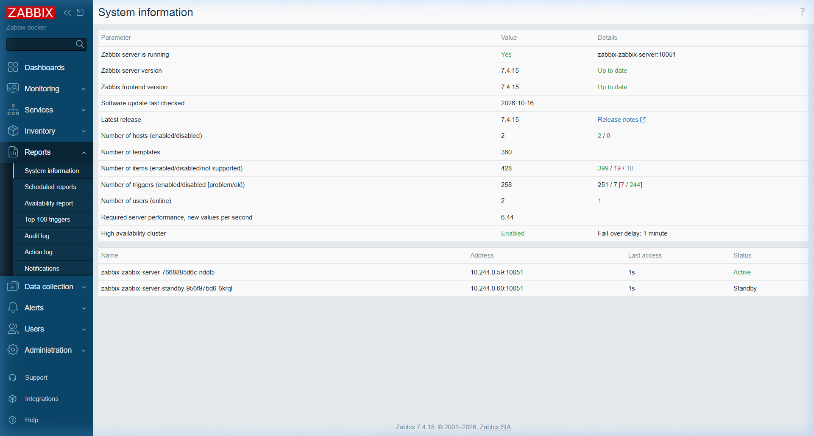
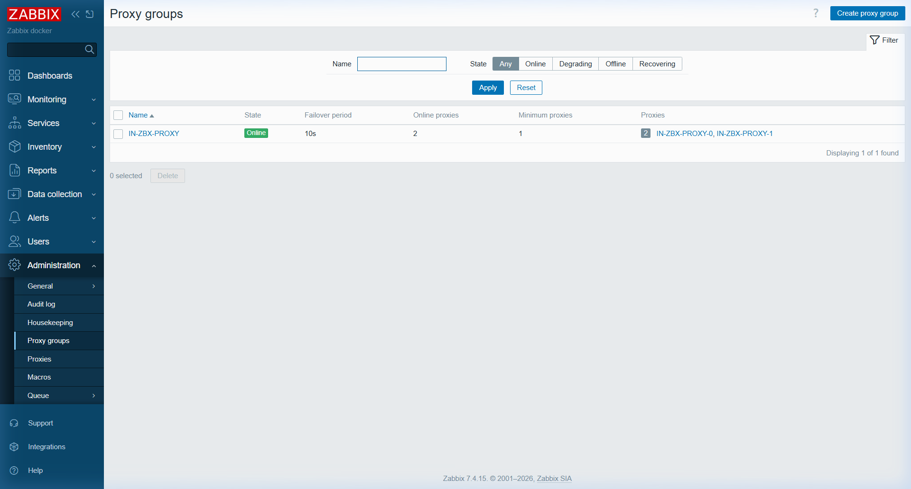
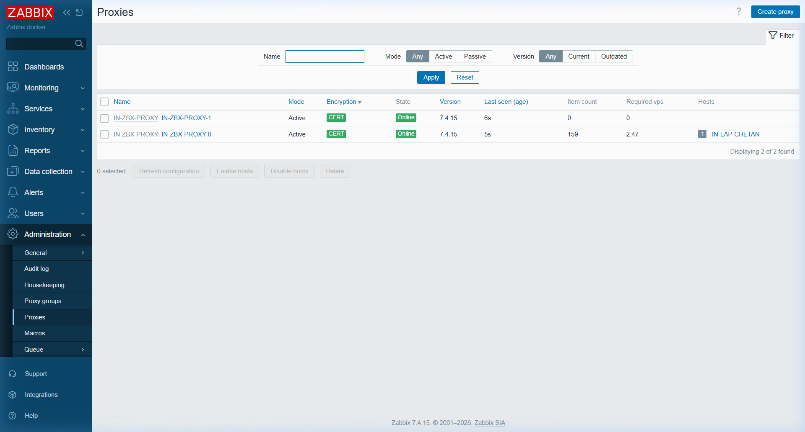
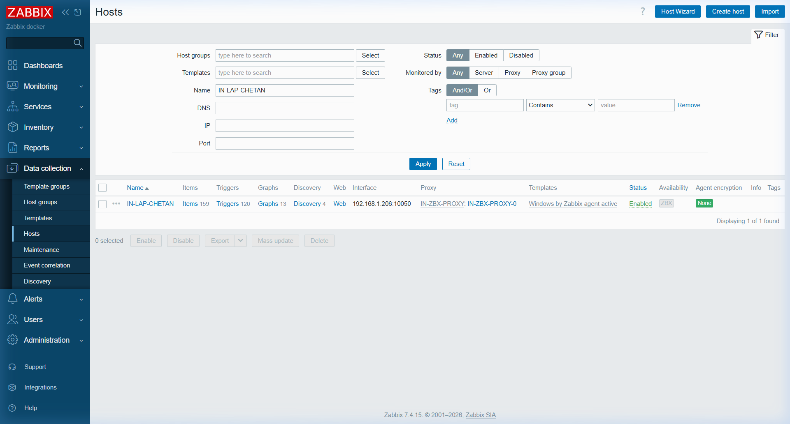
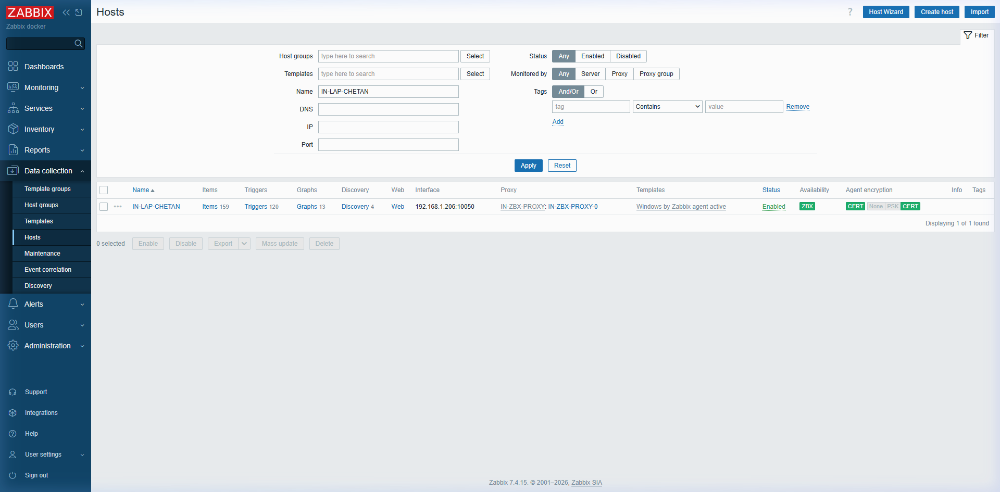
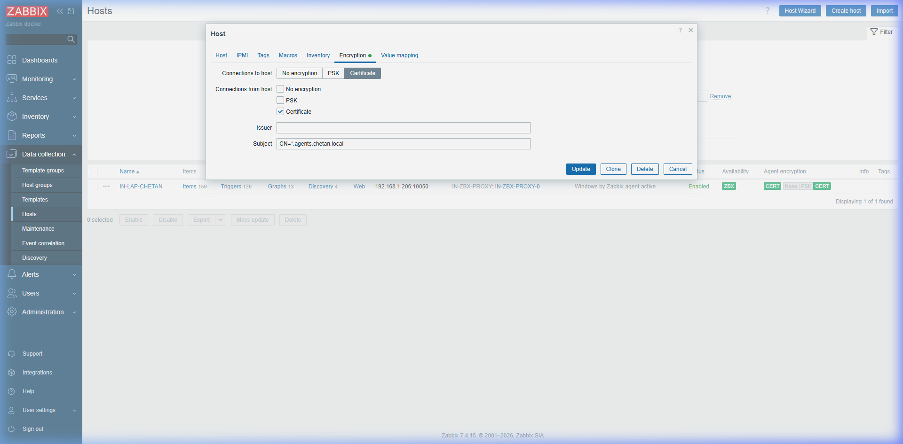

# 📊 Zabbix Monitoring Platform (Infra App)

Enterprise-grade distributed monitoring platform deployed natively on Kubernetes via Helm and declarative GitOps (Argo CD).

---

## 🏗️ Architecture & High Availability (HA) Design

```
                               ┌─────────────────────────────────────────┐
                               │     Traefik Gateway (main-gateway)      │
                               │     Port 443 Wildcard TLS Termination   │
                               └────────────────────┬────────────────────┘
                                                    │
                 ┌──────────────────────────────────┼──────────────────────────────────┐
                 │ (zabbix.chetan.local)            │ (zbx-srv.chetan.local)           │ (zbx-proxy.chetan.local)
                 ▼                                  ▼                                  ▼
       ┌────────────────────┐             ┌────────────────────┐          ┌───────────────────────────────────┐
       │   Zabbix Web UI    │             │   Zabbix Server    │          │    Proxy Group: IN-ZBX-PROXY      │
       │  (Nginx Frontend)  │◄───────────►│ (7.4-latest pgsql) │◄─────────┤  (Active HA & Load Balancing)     │
       │                    │             │    [ACTIVE NODE]   │   mTLS   │                                   │
       └─────────┬──────────┘             └─────────┬──────────┘  TCP     │ ┌───────────────┐ ┌─────────────┐ │
                 │                                  │             10051   │ │IN-ZBX-PROXY-0 │ │IN-ZBX-PROXY-1││
                 │                                  │                     │ │(StatefulSet)  │ │(Deployment) │ │
                 │                        ┌─────────┴──────────┐          │ └───────┬───────┘ └─────────────┘ │
                 │                        │   Zabbix Server    │          └─────────┼─────────────────────────┘
                 │                        │ (7.4-latest pgsql) │                    │ (Shared emptyDir)
                 │                        │   [STANDBY NODE]   │                    ▼
                 │                        └─────────┬──────────┘          ┌────────────────────┐
                 │                                  │                     │   SNMP Trapper     │
                 │                                  │                     │ (zabbix-snmptraps) │
                 │                                  │                     │  UDP 162 / hostPort│
                 ▼                                  ▼                     └────────────────────┘
       ┌───────────────────────────────────────────────────────┐                    ▲
       │             TimescaleDB 2.17.2 (PG16)                 │                    │
       │   • High-performance time-series metric storage       │          ┌─────────┴──────────┐
       │   • Distributed HA cluster coordination (ha_node)     │◄─────────┤   Zabbix Agent 2   │
       │   • Proxy Group routing & dynamic host allocation     │          │ (Node DaemonSet)   │
       └───────────────────────────────────────────────────────┘          └────────────────────┘
```

---

## 🚀 Key Architectural Features

### 1. Native Zabbix Server High Availability (HA) Cluster
* **Active-Passive Redundancy**: Two Zabbix Server instances (`zabbix-zabbix-server` and `zabbix-zabbix-server-standby`) run simultaneously against the same TimescaleDB database.
* **Database Heartbeat & Auto-Discovery**: Nodes register themselves into the database `ha_node` table via `ZBX_AUTOHANODENAME: "hostname"` and send heartbeats every 5 seconds.
* **Automatic Failover**: One node is elected **`Active`** (executes pollers, alerts, escalators), while the other node stays in **`Standby`** mode. If the active node crashes or restarts, the standby node promotes itself to Active within seconds with zero data loss.
* **Automated Orphan Node Cleanup (`haNodesAutoClean`)**: When Kubernetes rolls out new pods or restarts nodes, previous pods gracefully stop. To ensure the cluster status page (`report.status`) only shows active/standby nodes without displaying stale terminated servers, an automated CronJob (`haNodesAutoClean`) runs every 5 minutes (`*/5 * * * *`) purging stopped and unavailable nodes older than 300 seconds:
  ```sql
  DELETE FROM ha_node WHERE status IN (1, 2) AND EXTRACT(epoch FROM now()) - lastaccess > 300;
  ```
* **Frontend Cluster Discovery**: The Web frontend automatically queries the database `ha_node` table and routes user requests directly to the active cluster node.
* **Live Clean HA Cluster Status**:
  

### 2. Decoupled SNMP Trapper via Zabbix Proxy (Approach C)
* **Dedicated SNMP Trapper Sidecar**: The `zabbix-snmptraps` container is attached as a sidecar to the primary **Zabbix Proxy** (`IN-ZBX-PROXY-0` in `zabbix-zabbix-proxy-0`) instead of the core server.
* **HostPort 162 Ingestion**: Binds to `hostPort: 162/UDP` and Service `zabbix-snmptraps` (`162/UDP -> 1162/UDP`), receiving traps from network devices via `zbx-snmp.chetan.local:162`.
* **Zero Shared-Storage Bottleneck**: Traps are written to `/var/lib/zabbix/snmptraps/snmptraps.log` on a pod-local `emptyDir` volume, read by the proxy's `snmp trapper` daemon, and forwarded over standard encrypted TCP (port 10051) to the active Zabbix Server.
* **No Server Scaling Conflicts**: Server pods remain completely lightweight and free from `hostPort: 162` port collisions.

### 3. Zabbix Proxy Groups: Multi-Proxy Regional HA & Load Balancing (Method 1)
* **Proxy Group `IN-ZBX-PROXY`**: An enterprise group of active proxies deployed at the regional site (India), enabling high availability, automatic failover, and load distribution.
* **Dual Active Proxies**:
  * **`IN-ZBX-PROXY-0`**: Primary StatefulSet proxy pod (`zabbix-zabbix-proxy-0`) with persistent volume, SNMP trappers sidecar (`hostPort: 162/UDP`), and cert-manager mTLS.
  * **`IN-ZBX-PROXY-1`**: Secondary Deployment proxy pod (`in-zbx-proxy-1`) providing hot standby and horizontal monitoring capacity with cert-manager mTLS.
* **Native Server Proxy Group Manager**: The core Zabbix Server runs daemon process `proxy group manager #1`, continuously monitoring proxy heartbeats and automatically assigning hosts across online proxies.
* **Rapid Automatic Failover**: Configured with `failover_delay: 10s` and `min_online: 1`. If an active proxy fails or restarts, the server automatically reallocates its monitored hosts to the remaining online proxy within 10 seconds without dropping metrics.
* **Full cert-manager mTLS**: All proxies connect outbound to `zbx-srv.chetan.local:10051` using X.509 certificates signed by `ClusterIssuer/local-ca-issuer` (`tls_connect = 4, tls_accept = 4`).

### 4. TimescaleDB 2.17.2 & PostgreSQL 16
* **Hypertable Partitioning & Compression**: Automatically compresses history and trend data, offering 10x-20x storage efficiency compared to standard relational tables.
* **10Gi Persistent Storage**: Persistent volume for long-term telemetry and metrics retention.

### 5. Zabbix Agent 2 Cluster-Wide DaemonSet
* Modern Go-based monitoring agent deployed across all Kubernetes nodes.
* Connected to both cluster nodes (`zabbix-zabbix-server,zabbix-zabbix-server-standby`) for active and passive node metrics collection.

---

## 🌐 Endpoints & Credentials

| Component | Hostname / URL | In-Cluster Service | Port / Protocol | Description |
| :--- | :--- | :--- | :--- | :--- |
| **Web UI** | `https://zabbix.chetan.local` | `zabbix-zabbix-web` | `80` (HTTP) | Web Dashboard & JSON-RPC API |
| **Server (Active)** | `zbx-srv.chetan.local` | `zabbix-zabbix-server` | `10051` (TCP) | Metric Trapper & Server Daemon |
| **Server (Standby)**| `zabbix-zabbix-server-standby` | `zabbix-zabbix-server-standby` | `10051` (TCP) | Standby HA Server Node |
| **Proxy Group** | `IN-ZBX-PROXY` | N/A (Logical Group) | N/A | Regional Active Proxy Group (HA & LB) |
| **Proxy 0** | `zbx-proxy.chetan.local` | `zabbix-zabbix-proxy` | `10051` (TCP) | Primary Proxy (`IN-ZBX-PROXY-0`) + SNMP Traps |
| **Proxy 1** | `in-zbx-proxy-1.zabbix.svc` | `in-zbx-proxy-1` | `10051` (TCP) | Secondary Proxy (`IN-ZBX-PROXY-1`) |
| **SNMP Trapper** | `zbx-snmp.chetan.local` | `zabbix-snmptraps` | `162` (UDP) | Net-SNMP Trap Receiver |

### Default Credentials
* **Web UI Username**: `Admin` (case-sensitive)
* **Web UI Password**: `zabbix`
* **TimescaleDB User**: `zabbix`
* **TimescaleDB Password**: `Zabbix12345`

---

---

## 📂 File Inventory & Directory Structure

```
05-infra-apps/06-zabbix/
├── install-zabbix.sh           # Automated installer script (Helm, HTTPRoute, DB bootstrap)
├── zabbix-values.yaml          # Helm values (HA nodes, TimescaleDB, Proxy SNMP sidecar, mTLS)
├── zabbix-certificates.yaml    # cert-manager X.509 Certificates (mTLS for Server & Proxies)
├── zabbix-httproute.yaml       # Gateway API HTTPRoute connecting zabbix.chetan.local
├── zabbix-application.yaml     # Standalone Argo CD Application manifest for GitOps
└── README.md                   # Comprehensive architecture, operational guide & verification
```

### Detailed Breakdown of Files

1. **[`install-zabbix.sh`](install-zabbix.sh)**:
   * **Purpose**: Orchestrates the standalone or pre-Argo CD automated installation of the entire Zabbix monitoring platform.
   * **Key Capabilities**:
     * Automatically sources parent `.env` configuration via `load-env.sh`.
     * Automatically detects local offline Helm chart tarballs (`airgap/charts/zabbix-*.tgz`) or connects to the online repository (`zabbix-community`).
     * Executes `helm upgrade --install` with custom values and database secrets.
     * Applies Gateway API `HTTPRoute` with automatic domain interpolation (`sed s|chetan.local|${MAIN_DOMAIN}|g`).
     * Monitors workload rollouts for deployments (`server`, `server-standby`, `web`), statefulsets (`postgresql`, `proxy`), and daemonsets (`agent`).
     * Bootstraps PostgreSQL database tables (`interface`, `proxy`, `proxy_rtdata`) so that the active proxy (`zbx-proxy`) and server agent interface are instantly `Online` without manual Web UI setup.
     * Displays a clean verification summary with URLs, credentials, and DNS records.

2. **[`zabbix-values.yaml`](zabbix-values.yaml)**:
   * **Purpose**: Centralized Helm configuration defining all components and container parameters.
   * **Key Configurations**:
     * `postgresql`: Deploys TimescaleDB 2.17.2 on PostgreSQL 16 with 10Gi persistent storage and 150 max connections.
     * `zabbixServer`: Configures the primary active server pod with `ZBX_AUTOHANODENAME: hostname`, `ENABLE_TIMESCALEDB: "true"`, and `ZBX_DBEXTENDEDSTATUS: "1"`.
     * `extraManifests`: Declares the secondary standby server node (`Deployment/zabbix-zabbix-server-standby`) enabling native active-passive HA cluster mode.
     * `zabbixProxy`: Configures the SQLite3 proxy daemon, attaches the `zabbix-snmptraps` sidecar container binding to `hostPort: 162/UDP`, mounts shared `snmptraps-dir` (`emptyDir`), creates Service `zabbix-snmptraps`, and sets `ZBX_SERVER_HOST: "zabbix-zabbix-server;zabbix-zabbix-server-standby"`.
     * `zabbixAgent`: Deploys modern Go-based Agent 2 as a cluster-wide Kubernetes `DaemonSet` monitoring all nodes.
     * `zabbixWeb`: Configures Nginx frontend, connects to cluster servers, and enables Gateway API HTTP routing.
     * `zabbixWebservice`: Deploys Google Chrome headless web service for scheduled dashboard and report PDF generation.

3. **[`zabbix-httproute.yaml`](zabbix-httproute.yaml)**:
   * **Purpose**: Kubernetes Gateway API `HTTPRoute` resource attaching `zabbix.chetan.local` to `Gateway/main-gateway` in the `default` namespace.
   * **Routing**: Matches path `/` (PathPrefix) and forwards cleartext traffic to Service `zabbix-zabbix-web:80`, with TLS terminated at the Gateway using the `*.chetan.local` wildcard certificate.

4. **[`zabbix-application.yaml`](zabbix-application.yaml)**:
   * **Purpose**: Declarative Argo CD `Application` Custom Resource manifest for GitOps management.
   * **Tracking**: Points directly to Helm repository `https://zabbix-community.github.io/helm-zabbix` chart `zabbix` version `7.1.0` with full in-line `valuesObject`.
   * **Sync Policies**: Configured with `automated` sync, `prune: false`, `selfHeal: true`, and sync-wave `2` for seamless platform orchestration.

5. **[`zabbix-certificates.yaml`](zabbix-certificates.yaml)**:
   * **Purpose**: cert-manager Custom Resources (`Certificate`) generating X.509 TLS keypairs for Zabbix Server and Proxies from `ClusterIssuer/local-ca-issuer`.
   * **Key Specifications**:
     * `Certificate/zabbix-server-tls`: Issues secret `zabbix-server-tls-secret` for server SANs (`zbx-srv.chetan.local`, `zabbix-zabbix-server`, `zabbix-zabbix-server-standby`).
     * `Certificate/zabbix-proxy-tls`: Issues secret `zabbix-proxy-tls-secret` for proxy SANs (`zbx-proxy`, `zbx-proxy.chetan.local`, `zabbix-zabbix-proxy`).
     * Auto-renewal 30 days prior to 1-year expiry.

---

## 🛠️ Automated Installer Script Guide (`install-zabbix.sh`)

### How to Use

The script can be executed from Git Bash, Linux/macOS terminal, or Windows PowerShell:

#### 1. Standard Execution (Default Settings)
```bash
./05-infra-apps/06-zabbix/install-zabbix.sh
```

#### 2. Custom Domain Execution
```bash
MAIN_DOMAIN="mycompany.local" ./05-infra-apps/06-zabbix/install-zabbix.sh
```

#### 3. Custom Credentials & Namespace
```bash
ZABBIX_NAMESPACE="monitoring" \
ZABBIX_ADMIN_PASSWORD="SuperSecretPassword123" \
ZABBIX_DB_PASSWORD="DbSecretPassword123" \
./05-infra-apps/06-zabbix/install-zabbix.sh
```

#### 4. Windows PowerShell Execution
```powershell
bash 05-infra-apps/06-zabbix/install-zabbix.sh
```

---

### Command-Line Arguments & Flags

`install-zabbix.sh` is designed for seamless GitOps and CI/CD pipelines following twelve-factor app principles:
* **Arguments**: Accepts zero mandatory positional arguments.
* **Auto-Discovery**: Automatically searches parent directories for `load-env.sh` and extracts variables from root `.env`.
* **Path Conversion**: Automatically detects MSYS2/Git Bash environments and invokes `cygpath -w` to ensure Windows paths are passed properly to Helm and kubectl.
* **Offline Detection**: Automatically probes for offline `.tgz` chart archives in `airgap/charts/` before attempting to reach external Helm repositories.

---

### Configuration Variables & Environment Variables

All variables have robust built-in defaults and can be overridden via shell environment variables or `.env`:

| Environment Variable | Default Value | Description |
| :--- | :--- | :--- |
| **`MAIN_DOMAIN`** | `chetan.local` | Base domain used to derive all service FQDNs. |
| **`ZABBIX_HOST`** | `zabbix.${MAIN_DOMAIN}` | FQDN for the Web UI and Gateway API HTTPRoute (`zabbix.chetan.local`). |
| **`ZABBIX_SRV_HOST`** | `zbx-srv.${MAIN_DOMAIN}` | FQDN for the active server daemon (`zbx-srv.chetan.local`). |
| **`ZABBIX_PROXY_HOST`** | `zbx-proxy.${MAIN_DOMAIN}` | FQDN for the proxy buffer daemon (`zbx-proxy.chetan.local`). |
| **`ZABBIX_NAMESPACE`** *(or `NAMESPACE`)* | `zabbix` | Target Kubernetes namespace. Created automatically if missing. |
| **`ZABBIX_RELEASE_NAME`** *(or `RELEASE_NAME`)* | `zabbix` | Helm release name. |
| **`ZABBIX_HELM_REPO_URL`** | `https://zabbix-community.github.io/helm-zabbix` | Official Helm chart repository URL. |
| **`ZABBIX_HELM_CHART`** | `zabbix-community/zabbix` | Helm chart reference name. |
| **`ZABBIX_CHART_VERSION`** | `7.1.0` | Target Helm chart version (app version 7.4.15). |
| **`ZABBIX_ADMIN_USER`** *(or `ZABBIX_USER`)* | `Admin` | Initial administrative username for the Web UI. |
| **`ZABBIX_ADMIN_PASSWORD`** *(or `ZABBIX_PASS`)* | `zabbix` | Initial administrative password for the Web UI. |
| **`ZABBIX_DB_PASSWORD`** *(or `ZABBIX_DB_PASS`)* | `Zabbix12345` | PostgreSQL database password for the `zabbix` database user. |

---

### Step-by-Step Script Execution Flow

When executed, `install-zabbix.sh` carries out the following operational steps:

1. **Step 0: Helm Chart Resolution**: Probes `airgap/charts/zabbix-7.1.0.tgz`. If present, installs 100% offline. If missing, adds and updates the `zabbix-community` repository.
2. **Step 1: Helm Deployment**: Executes `helm upgrade --install` applying `zabbix-values.yaml` and sets the database password with a 10-minute rollout timeout.
3. **Step 2: Gateway API HTTPRoute Application**: Applies `zabbix-httproute.yaml`. If `MAIN_DOMAIN` is overridden, it dynamically rewrites the hostname via `sed` before applying with `--server-side --force-conflicts`.
4. **Step 3: Workload Rollout Readiness**: Monitors rollouts using `kubectl rollout status` for:
   * Deployments: `zabbix-zabbix-server`, `zabbix-zabbix-server-standby`, `zabbix-zabbix-web`
   * StatefulSets: `zabbix-postgresql`, `zabbix-zabbix-proxy`
   * DaemonSet: `zabbix-zabbix-agent`
5. **Step 3b: Automated Database Bootstrapping**: Connects to `zabbix-postgresql-0` and executes idempotent SQL queries to:
   * Update the primary host interface to use DNS `zabbix-zabbix-agent` instead of static IP `127.0.0.1`.
   * Register proxy name `zbx-proxy` in the `proxy` table.
   * Mark `proxy_rtdata` with `state: 2` (Online) and `version: 70415` so the Web UI displays green status immediately.
6. **Step 4: Summary & Route Display**: Prints active HTTPRoutes, running pods, URLs, credentials, and required `/etc/hosts` mappings.

---

## 🌐 Local DNS Setup
Ensure local host resolution is added to your hosts file:
* **Windows (PowerShell as Admin)**:
  ```powershell
  Add-Content -Path C:\Windows\System32\drivers\etc\hosts -Value "127.0.0.1 zabbix.chetan.local zbx-srv.chetan.local zbx-proxy.chetan.local zbx-snmp.chetan.local"
  ```
* **Linux / macOS**:
  ```bash
  echo "127.0.0.1 zabbix.chetan.local zbx-srv.chetan.local zbx-proxy.chetan.local zbx-snmp.chetan.local" | sudo tee -a /etc/hosts
  ```

---

## 🔍 Verification & Inspection Commands

### Check HA Cluster Nodes in Database
```bash
kubectl exec -n zabbix zabbix-postgresql-0 -- psql -U zabbix -d zabbix -c \
  "SELECT name, address, port, lastaccess, status FROM ha_node;"
```
*(Status `3` = Active, Status `0` = Standby)*

### Check Proxy Online Status
```bash
kubectl exec -n zabbix zabbix-postgresql-0 -- psql -U zabbix -d zabbix -c \
  "SELECT proxyid, lastaccess, version, state FROM proxy_rtdata;"
```
*(State `2` = Online)*

### Send a Test SNMP Trap (UDP 162)
```powershell
# PowerShell Test Script
$snmpTrapHex = "304602010104067075626c6963a739020400000001020100020100302b301306082b060102010103004307000000000003e83014060a2b06010603010104010006062b0601040101"
$bytes = [byte[]] -split ($snmpTrapHex -replace '..', '0x$& ')
$client = New-Object System.Net.Sockets.UdpClient
$client.Connect("127.0.0.1", 162)
$client.Send($bytes, $bytes.Length)
$client.Close()
```

Inspect received trap log:
```bash
kubectl exec -n zabbix zabbix-zabbix-proxy-0 -c zabbix-proxy -- cat /var/lib/zabbix/snmptraps/snmptraps.log
```

### Check Web UI Status
1. **HA Cluster Details**: Open `https://zabbix.chetan.local/zabbix.php?action=system.info` -> verify **High availability cluster: Enabled**.
2. **Proxy Status**: Open `https://zabbix.chetan.local/zabbix.php?action=proxy.list` -> verify `zbx-proxy` shows green badge **Online**.

---

## 🔌 Adding Devices, Network Switches, PLCs & Hosts into Zabbix

Zabbix supports agentless polling (SNMP, Modbus, ICMP, IPMI), event-driven ingestion (SNMP Traps), and agent-based telemetry (Zabbix Agent 2). 

### Monitoring Protocol Matrix

| Target Type | Examples | Primary Protocols | Port / Transport | Recommended Zabbix Template | Proxy Recommendation |
| :--- | :--- | :--- | :--- | :--- | :--- |
| **Network Switches / Routers** | Cisco Catalyst, Juniper, Arista, MikroTik, HP/Aruba | SNMP v2c / v3, SNMP Traps | `161/UDP` (Poll)<br>`162/UDP` (Traps) | `Cisco IOS by SNMP`<br>`Network Generic Device SNMP`<br>`MikroTik by SNMP` | **`zbx-proxy`** (Keeps SNMP traffic local to network segment) |
| **Industrial PLCs & Controllers** | Siemens S7-1200/1500, Schneider M241/M251, Rockwell/Allen-Bradley, WAGO | Modbus TCP, SNMP, MQTT, OPC-UA | `502/TCP` (Modbus)<br>`161/UDP` (SNMP)<br>`1883/TCP` (MQTT) | Modbus TCP Templates<br>`modbus.get[...]` Plugin<br>Generic SNMP / Custom MIB | **`zbx-proxy`** (Essential for OT/IT isolation & firewall traversal) |
| **Linux / Windows Hosts & VMs** | Ubuntu, Debian, RHEL, Windows Server | Zabbix Agent 2 (Active/Passive) | `10050/TCP` (Passive)<br>`10051/TCP` (Active) | `Linux by Zabbix agent active`<br>`Windows by Zabbix agent active` | Either `(no proxy)` or `zbx-proxy` |
| **Unmanaged / Edge Devices** | Printers, IP Cameras, PDU, UPS | ICMP Ping, SNMP, HTTP/REST | `ICMP`<br>`161/UDP` (SNMP) | `ICMP Ping`<br>`APC UPS by SNMP` | **`zbx-proxy`** |

---

### 1. 🖧 How to Add Network Switches & Routers (SNMP)

#### Step 1: Configure SNMP on Your Switch
Enable SNMP v2c/v3 and configure the SNMP Trap target on your network switch.

* **Cisco IOS Example**:
  ```text
  enable
  configure terminal
  snmp-server community MyCompanyCommunity RO
  snmp-server location DataCenter-Rack-04
  snmp-server contact devops@chetan.local
  ! Send SNMP Traps to Zabbix Proxy Sidecar
  snmp-server host 127.0.0.1 version 2c MyCompanyCommunity
  snmp-server enable traps
  end
  write memory
  ```

* **MikroTik RouterOS Example**:
  ```text
  /snmp community add name=MyCompanyCommunity addresses=0.0.0.0/0 read-access=yes
  /snmp set enabled=yes location="Server Room" contact="admin@chetan.local" trap-version=2 trap-target=127.0.0.1 trap-community=MyCompanyCommunity
  ```

#### Step 2: Add Switch Host in Zabbix Web UI
1. Open [https://zabbix.chetan.local](https://zabbix.chetan.local) and log in (`Admin` / `zabbix`).
2. Navigate to **Data collection > Hosts** and click **Create host** (top-right).
3. **Host Tab**:
   * **Host name**: `core-switch-01`
   * **Visible name**: `Core Switch 01 (Rack 4)`
   * **Host groups**: Select `Templates/Network devices` or create `Switches`.
   * **Interfaces**: Click **Add** -> select **SNMP**:
     * **IP address**: Device LAN IP (e.g., `192.168.1.50`).
     * **DNS name**: Leave blank or set FQDN.
     * **Connect to**: Select **IP**.
     * **Port**: `161`.
     * **SNMP version**: `SNMPv2`.
     * **SNMP community**: `{$SNMP_COMMUNITY}` (uses a secure macro).
   * **Monitored by proxy**: Select **`zbx-proxy`** *(Recommended: Proxy performs local polling and forwards metrics securely)*.
4. **Templates Tab**:
   * Link one of the built-in official templates:
     * `Cisco IOS by SNMP` (or `Cisco IOS XE by SNMP`)
     * `Network Generic Device SNMP` (interfaces, CPU, memory, uptime for any vendor)
     * `Juniper by SNMP`, `Aruba by SNMP`, `MikroTik by SNMP`
5. **Macros Tab**:
   * Click **Inherited and host macros**.
   * Find or add `{$SNMP_COMMUNITY}` and set its value to your community string (e.g. `MyCompanyCommunity`).
6. Click **Add**.

#### Step 3: Verify SNMP Polling & Traps
* **Check Interface Availability**: In **Data collection > Hosts**, the **SNMP** icon next to `core-switch-01` will turn **green** within 30–60 seconds.
* **Test SNMP Connectivity from Proxy**:
  ```bash
  kubectl exec -n zabbix zabbix-zabbix-proxy-0 -c zabbix-proxy -- \
    snmpwalk -v2c -c MyCompanyCommunity 192.168.1.50 1.3.6.1.2.1.1.1.0
  ```
* **Verify Traps**: Any link-down or power-supply alert generated by the switch arrives at `zbx-snmp.chetan.local:162/UDP`, logs to `/var/lib/zabbix/snmptraps/snmptraps.log`, and triggers alarms in **Monitoring > Problems**.

---

### 2. 🏭 How to Add Industrial PLCs & Automation Equipment (OT)

Industrial environments (factory floors, water treatment, packaging lines) typically feature **Programmable Logic Controllers (PLCs)** from Siemens, Schneider Electric, Allen-Bradley (Rockwell), Omron, or WAGO.

#### Approach A: Modbus TCP Protocol (Standard Port 502)
Modbus TCP is the universal communication protocol used across industrial automation to read sensor values, motor RPM, coil states, and fault codes.

1. **How Zabbix Collects Modbus Telemetry**:
   Zabbix Agent 2 includes a native, high-performance **Modbus Plugin**.
   The polling syntax is:
   ```text
   modbus.get[endpoint,slave_id,function_code,address,count]
   ```
   * **Function Codes**:
     * `1` = Read Coils (Digital outputs, discrete status: On/Off)
     * `2` = Read Discrete Inputs (Digital inputs: sensor active/inactive)
     * `3` = Read Holding Registers (Analog setpoints, motor speeds, temperatures)
     * `4` = Read Input Registers (Analog sensor measurements: pressure, flow rate)

2. **Step-by-Step Configuration in Zabbix**:
   * In **Data collection > Hosts > Create host**:
     * **Host name**: `plc-line1-assembly`
     * **Monitored by proxy**: `zbx-proxy`
     * **Interfaces**: Add **Agent** interface with IP of a machine running Zabbix Agent 2 (or in-cluster proxy).
   * **Create Modbus Items**:
     * Go to the host's **Items** -> click **Create item**:
       * **Name**: `Motor Line 1 Speed (RPM)`
       * **Type**: `Zabbix agent` (or `Zabbix agent (active)`)
       * **Key**: `modbus.get[tcp://192.168.10.50:502,1,3,100,1]` *(Reads Holding Register 100 from Slave 1)*
       * **Type of information**: `Numeric (unsigned)`
       * **Update interval**: `5s`
     * To extract specific registers from a JSON array returned by Modbus batch reads:
       * In item **Preprocessing**, add: `JSONPath: $.[0]`

#### Approach B: SNMP on Industrial PLCs
Modern PLCs (Siemens S7-1200 / S7-1500 with CP modules, Schneider Modicon M241/M251) have embedded SNMP daemons:

1. **Enable SNMP in Engineering Software**:
   * **Siemens TIA Portal**: Go to PLC **Device Configuration** -> **PROFINET Interface** -> **SNMP** -> check **Enable SNMP**.
   * Set Community String (e.g. `public` or custom).
2. **Add to Zabbix**:
   * Add host with **SNMP Interface** (Port `161`).
   * Link template: `Network Generic Device SNMP` or vendor MIB template.
   * Monitored by proxy: `zbx-proxy`.

#### Approach C: MQTT / Industrial IoT Gateways
For smart sensors, vibration monitors, and IoT energy meters publishing to an MQTT broker:
* **Item Key**:
  ```text
  mqtt.get["tcp://broker.chetan.local:1883","factory/line1/plc/telemetry"]
  ```
* Use JSONPath preprocessing to extract temperature, current, and vibration metrics into individual Zabbix items.

---

---

### 3. 🖥️ How to Add Linux & Windows Hosts (Servers & Workstations)

#### 🔄 Active vs. Passive Checks Explained

| Feature | Passive Mode (`Windows by Zabbix agent`) | Active Mode (`Windows by Zabbix agent active`) |
| :--- | :--- | :--- |
| **Connection Flow** | **Server / Proxy ➡️ Agent** (Inbound to host) | **Agent ➡️ Server / Proxy** (Outbound from host) |
| **Agent Port** | **10050 / TCP** (Must be open on Windows Firewall) | **None required inbound!** (Port 10050 not needed) |
| **Server/Proxy Port** | None required on server side | **10051 / TCP** (Must be reachable from Agent) |
| **NAT / DHCP / WiFi** | ❌ Fails if laptop IP changes or is behind NAT | ✅ **Best: Works seamlessly behind NAT / DHCP / VPN** |
| **Network Outages** | ❌ Metrics lost during disconnects | ✅ **Agent buffers metrics locally until reconnected** |
| **CPU / Server Overhead** | Higher (Server pollers wait on network sockets) | **Lowest (Agent collects locally and pushes in bulk)** |
| **Template to Use** | `Windows by Zabbix agent` | `Windows by Zabbix agent active` |

```text
[ PASSIVE MODE ]
Zabbix Proxy ──────── TCP 10050 (Inbound) ────────► Zabbix Agent (IN-LAP-CHETAN)
   "Give me CPU!"                                      "Here is 15%"

[ ACTIVE MODE - RECOMMENDED ]
Zabbix Agent (IN-LAP-CHETAN) ──── TCP 10051 (Outbound) ────► Zabbix Proxy (zbx-proxy)
   1. "What items should I check?"                        1. Sends item list
   2. "Here is my CPU, RAM & disk data in a batch"        2. Stores in SQLite3 buffer
```

> [!IMPORTANT]
> **Never link both Passive and Active templates to the same host!**  
> If you attach both `Windows by Zabbix agent` and `Windows by Zabbix agent active`, Zabbix will block you with:  
> `Cannot inherit item with key "agent.hostname"... because an item with the same key is already inherited`.  
> **Fix**: Click **Unlink and clear** on `Windows by Zabbix agent` and link **ONLY** `Windows by Zabbix agent active`.

---

#### Step 1: Install Zabbix Agent 2 on the Target Host

* **Windows Setup (GUI Installer)**:
  Download the official MSI installer (`zabbix_agent2-7.4.15-windows-amd64-openssl.msi`) from [Zabbix Download Portal](https://www.zabbix.com/download_agents) and configure the setup wizard:

  | Installer Field | Recommended Value | Why? |
  | :--- | :--- | :--- |
  | **Host name** | `IN-LAP-CHETAN` | **Must match the "Host name" in Zabbix Web UI exactly (case-sensitive).** |
  | **Zabbix server IP/DNS** | `zbx-proxy.chetan.local` | Sets `Server=` in config. Whitelist of servers/proxies allowed to pull passive checks. |
  | **Agent listen port** | `10050` | Standard default agent listen port. |
  | **Server or Proxy for active checks** | `zbx-proxy.chetan.local` | Sets `ServerActive=` in config. **Address where agent pushes active metrics.** |

* **Linux (Ubuntu / Debian)**:
  ```bash
  wget https://repo.zabbix.com/zabbix/7.4/ubuntu/pool/main/z/zabbix-release/zabbix-release_latest_7.4+ubuntu24.04_all.deb
  sudo dpkg -i zabbix-release_latest_7.4+ubuntu24.04_all.deb
  sudo apt update && sudo apt install -y zabbix-agent2
  ```

* **Linux (RHEL / AlmaLinux / Rocky Linux 9)**:
  ```bash
  sudo rpm -Uvh https://repo.zabbix.com/zabbix/7.4/rhel/9/x86_64/zabbix-release-latest-7.4.el9.noarch.rpm
  sudo dnf install -y zabbix-agent2
  ```

---

#### Step 2: Configure `zabbix_agent2.conf`
If configuring via file (`C:\Program Files\Zabbix Agent 2\zabbix_agent2.conf` on Windows or `/etc/zabbix/zabbix_agent2.conf` on Linux):

```ini
# Passive Checks (Authorized pollers)
Server=zbx-proxy.chetan.local

# Active Checks (Destination proxy for active telemetry)
ServerActive=zbx-proxy.chetan.local

# Hostname matching Zabbix Web UI
Hostname=IN-LAP-CHETAN
```

Restart the agent service:
* **Windows**: Open `services.msc` -> restart **Zabbix Agent 2**.
* **Linux**: `sudo systemctl restart zabbix-agent2`

---

#### Step 3: Register Host in Zabbix Web UI
1. Go to **Data collection > Hosts** -> click **Create host** (or edit existing).
2. **Host Tab**:
   * **Host name**: `IN-LAP-CHETAN` (must match `Hostname` in `zabbix_agent2.conf` exactly).
   * **Templates**: Link **ONLY ONE** template:
     * For Active checks: **`Windows by Zabbix agent active`**
   * **Host groups**: `Discovered hosts` or `Workstations`.
   * **Interfaces**: Add **Agent** interface with your laptop IP (`192.168.1.206`), Port `10050`.
   * **Monitored by**: Click **`Proxy`** -> select **`zbx-proxy`** in the dropdown *(Do NOT select `Server`)*.
3. Click **Update** (or **Add**). Within 30 seconds, the host begins streaming metrics to `zbx-proxy`.

---

#### 🌐 Why Port 10051 (Not 443)?
* **Port 443 (HTTPS)**: Strictly for Traefik Gateway API web traffic (Zabbix Web UI and REST/JSON-RPC API).
* **Port 10051 (TCP)**: Dedicated to the raw binary Zabbix protocol (`ZBXD\x01...`). Zabbix agents do **not** speak HTTP/HTTPS; sending raw agent data to port 443 will fail because Traefik expects an SSL/TLS handshake.
* **Port 10051 Forwarding**: To allow external laptops (`IN-LAP-CHETAN`), switches, and PLCs to reach `zbx-proxy.chetan.local:10051`, KinD maps `hostPort: 10051` directly to the `zabbixProxy` pod.

---

### 4. 🛡️ Why Route Through `zbx-proxy`? (Enterprise Architecture)

In this infrastructure, we recommend setting **Monitored by proxy: `zbx-proxy`** for network switches, branch offices, and factory floor PLCs:

```
[ Factory Floor / Corporate LAN ]                [ Kubernetes Ingress ]
Switches (SNMP :161)    ──┐
PLCs (Modbus :502)      ──┼──► zbx-proxy (SQLite3) ──── TCP 10051 ────► Zabbix HA Cluster
SNMP Traps (:162 UDP)   ──┘       (Sidecar Trapper)
```

1. **Firewall & Security Hardening**:
   * Only **one outbound TCP port (10051)** needs to be opened between your network and the Kubernetes cluster.
   * Internal switches and OT PLCs never need their management IPs exposed outside their local VLAN.
2. **Local SNMP Trap Aggregation**:
   * UDP packets cannot be routed reliably over high-latency WAN connections. The proxy receives traps locally and forwards them over encrypted TCP.
3. **Buffer During Maintenance & Failovers**:
   * If Kubernetes nodes restart or the Zabbix Server fails over between HA nodes, `zbx-proxy` caches telemetry in its local SQLite3 database and streams all buffered data once the connection resumes, guaranteeing **zero data loss**.

---

## 🔒 End-to-End mTLS Certificate Encryption (cert-manager & X.509)

To ensure bank-grade security across untrusted networks and the public internet, the connection between **Zabbix Server** and **Zabbix Proxies** is encrypted and mutually authenticated using **X.509 digital certificates** issued automatically by **cert-manager**.

### 1. Why Certificate Encryption (mTLS) instead of PSK?

| Feature | X.509 Certificate Encryption (mTLS) *(Implemented)* | Pre-Shared Key (PSK) |
| :--- | :--- | :--- |
| **Authentication Type** | Mutual asymmetric public-key cryptography (RSA 2048-bit) | Symmetric shared secret password |
| **Automation & Lifecycle** | **Automated** by Kubernetes `cert-manager` (rotation, renewal) | Manual distribution, manual text-file maintenance |
| **Multi-Site Scalability** | **High**: Each regional proxy (India, China, US) receives its own unique certificate signed by the central CA | Low: Sharing the same PSK across all sites compromises all if one is leaked |
| **Subject/Issuer Verification** | **Yes**: Server validates exact Certificate Subject and CA Issuer | None: Authenticates only by shared string match |
| **Revocation & Zero Trust** | Supported via CRL / CA trust boundary | Requires manually updating all servers & proxies |

---

### 2. Kubernetes cert-manager Architecture

```
                       ┌───────────────────────────────────┐
                       │   cert-manager (local-ca-issuer)  │
                       │    Internal Root Certificate CA   │
                       └─────────────────┬─────────────────┘
                                         │
                 ┌───────────────────────┴───────────────────────┐
                 │ Issues Server Cert                            │ Issues Proxy Cert
                 ▼                                               ▼
       ┌────────────────────────┐                     ┌────────────────────────┐
       │   Secret:              │                     │   Secret:              │
       │   zabbix-server-tls    │                     │   zabbix-proxy-tls     │
       │   - ca.crt             │                     │   - ca.crt             │
       │   - tls.crt            │                     │   - tls.crt            │
       │   - tls.key            │                     │   - tls.key            │
       └───────────┬────────────┘                     └───────────┬────────────┘
                   │ Mounts: /etc/zabbix/tls                      │ Mounts: /etc/zabbix/tls
                   ▼                                              ▼
       ┌────────────────────────┐    mTLS (Encrypted TCP)     ┌────────────────────────┐
       │      Zabbix Server     │◄═══════════════════════════►│      Zabbix Proxy      │
       │ (Active & Standby HA)  │       Port 10051            │   (zbx-proxy, regional)│
       └────────────────────────┘                             └────────────────────────┘
```

1. **Root CA (`ClusterIssuer/local-ca-issuer`)**:
   Issues cryptographic certificates within the Kubernetes cluster.
2. **Server TLS Secret (`zabbix-server-tls-secret`)**:
   Mounted into both the Active (`zabbix-zabbix-server`) and Standby (`zabbix-zabbix-server-standby`) pods at `/etc/zabbix/tls`.
   Configured with:
   * `ZBX_TLSCAFILE: "/etc/zabbix/tls/ca.crt"`
   * `ZBX_TLSCERTFILE: "/etc/zabbix/tls/tls.crt"`
   * `ZBX_TLSKEYFILE: "/etc/zabbix/tls/tls.key"`
3. **Proxy TLS Secret (`zabbix-proxy-tls-secret`)**:
   Mounted into `zabbix-zabbix-proxy` at `/etc/zabbix/tls`.
   Configured with:
   * `ZBX_TLSCONNECT: "cert"` (strictly connects using TLS Certificate)
   * `ZBX_TLSACCEPT: "cert,unencrypted"` (accepts cert connections)
   * `ZBX_TLSCAFILE: "/etc/zabbix/tls/ca.crt"`
   * `ZBX_TLSCERTFILE: "/etc/zabbix/tls/tls.crt"`
   * `ZBX_TLSKEYFILE: "/etc/zabbix/tls/tls.key"`
4. **Database-Level Strict Enforcement**:
   In PostgreSQL `proxy` table:
   * `tls_connect = 4` (`HOST_ENCRYPTION_CERTIFICATE`)
   * `tls_accept = 4` (`HOST_ENCRYPTION_CERTIFICATE`)
   * *(Note: In Zabbix database constants: `1 = None`, `2 = PSK`, `4 = Certificate`)*.
   * If any unencrypted client tries to impersonate the proxy, the server terminates the socket immediately:
     `cannot accept connection from proxy "zbx-proxy": connection of type "unencrypted" is not allowed for proxy "zbx-proxy"`.

---

## 🌍 Distributed Multi-Site Architecture: Regional Proxy Groups (Method 1)

In global enterprise deployments, organizations operate multiple remote branches and industrial facilities across the globe (e.g., **India, China, the US, and Europe**). Each site contains hundreds of OT/IT devices—such as industrial PLCs, network core/access switches, and Windows/Linux server racks.

To deliver **high availability (HA)**, **failover resilience**, and **horizontal load balancing** at every site without exposing internal networks over WAN, Zabbix employs **Proxy Groups (Method 1)**:
* Each regional site runs an autonomous **Proxy Group** (e.g., `IN-ZBX-PROXY`, `US-ZBX-PROXY`, `CN-ZBX-PROXY`).
* Each Proxy Group contains **multiple redundant proxy nodes** (e.g., `IN-ZBX-PROXY-0`, `IN-ZBX-PROXY-1`).
* All proxy nodes communicate outbound over secure **cert-manager mTLS (`TCP 10051`)** with the central server cluster (**`HQ-ZBX-SERVER`** / `zbx-srv.chetan.local`).
* The central server dynamically balances monitored hosts across healthy online proxies and automatically reallocates hosts within **10 seconds** if any proxy node restarts or experiences a hardware fault.

---

### 🌐 Global Multi-Site Proxy Group Topology

```
       ┌────────────────────────────────────────────────────────────────────────────────────────┐
       │                       CENTRAL CLOUD / HQ KUBERNETES CLUSTER                             │
       │                                                                                        │
       │   Central Zabbix HA Server Cluster: HQ-ZBX-SERVER (Active / Standby)                   │
       │   Central Traefik Gateway: zbx-srv.chetan.local:10051 (TCP)                            │
       │   cert-manager: ClusterIssuer (local-ca-issuer)                                        │
       │   Daemon: proxy group manager #1 (Automated Host Balancing & Failover)                 │
       └──────────────────▲────────────────────────▲────────────────────────▲───────────────────┘
                          │                        │                        │
               mTLS (TCP 10051)         mTLS (TCP 10051)         mTLS (TCP 10051)
               Client Certificate       Client Certificate       Client Certificate
                          │                        │                        │
       ┌──────────────────┴─────────────┐ ┌────────┴──────────────────┐ ┌───┴───────────────────────┐
       │      INDIA SITE (Mumbai)       │ │     CHINA SITE (Shanghai)  │ │      US SITE (Dallas)     │
       │  ┌──────────────────────────┐  │ │  ┌──────────────────────┐  │ │  ┌──────────────────────┐ │
       │  │ Proxy Group: IN-ZBX-PROXY│  │ │  │Proxy Group:CN-ZBX-PROXY│ │ │  │Proxy Group:US-ZBX-PROXY│ │
       │  │ (Failover: 10s, Min: 1)  │  │ │  │(Failover: 10s, Min: 1) │ │ │  │(Failover: 10s, Min: 1) │ │
       │  │ ┌────────────┐┌───────────┐│ │ │ ┌──────────┐┌──────────┐│ │ │ ┌──────────┐┌──────────┐│ │
       │  │ │IN-ZBX-     ││IN-ZBX-    ││ │ │ │CN-ZBX-   ││CN-ZBX-   ││ │ │ │US-ZBX-   ││US-ZBX-   ││ │
       │  │ │PROXY-0     ││PROXY-1    ││ │ │ │PROXY-0   ││PROXY-1   ││ │ │ │PROXY-0   ││PROXY-1   ││ │
       │  │ └─────┬──────┘└─────┬─────┘│ │ │ └────┬─────┘└────┬─────┘│ │ │ └────┬─────┘└────┬─────┘│ │
       │  └───────┼─────────────┼──────┘  │ └──────┼──────────┼───────┘  │ └──────┼──────────┼───────┘  │
       │          │  Local LAN  │         │        │Local LAN │          │        │Local LAN │          │
       │     ┌────┴─────────────┴───┐     │   ┌────┴──────────┴────┐     │   ┌────┴──────────┴────┐     │
       │     ▼                      ▼     │   ▼                    ▼     │   ▼                    ▼     │
       │  Switches                PLCs    │Switches              PLCs    │Switches              PLCs    │
       │  (Cisco/Aruba)       (Siemens S7)│(Huawei)          (Schneider) │(Juniper/Arista)   (Rockwell) │
       └──────────────────────────────────┘ └────────────────────────────┘ └──────────────────────────┘
```

---

### ⚙️ How Zabbix Proxy Groups Work (Method 1)

1. **Autonomous Cluster daemons (`proxy group manager #1`)**:
   * The active Zabbix Server daemon runs an internal thread: `server #52 started [proxy group manager #1]`.
   * This manager monitors the database tables `proxy_group`, `proxy`, and `proxy_group_rtdata`.
2. **Proxy Heartbeats & Status Transitions**:
   * Each active proxy (`IN-ZBX-PROXY-0`, `IN-ZBX-PROXY-1`) dials `zbx-srv.chetan.local:10051` via cert-manager mTLS every few seconds.
   * When both proxies are healthy, the server marks the Proxy Group as **`Online`** (green badge).
   * If a proxy disconnects, the group transitions to **`Degrading`** or **`Offline`** based on `min_online`.
3. **Dynamic Host Balancing**:
   * Monitored targets (e.g., `IN-LAP-CHETAN`, Siemens PLCs, Cisco switches) are configured with:
     ```sql
     monitored_by = 2 (Proxy Group)
     proxy_groupid = 1 (IN-ZBX-PROXY)
     ```
   * The `proxy group manager` dynamically assigns hosts across available online proxies in the group and updates the internal routing table `host_proxy`.
4. **Sub-10s Zero-Loss Automated Failover**:
   * If `IN-ZBX-PROXY-0` experiences a hardware crash or node restart, the `proxy group manager` detects the missed heartbeat within `failover_delay` (`10s`) and automatically shifts all assigned hosts to `IN-ZBX-PROXY-1`.
   * When `IN-ZBX-PROXY-0` recovers, the server rebalances the hosts across both proxies.

---

### 🚀 Step-by-Step Guide: Deploying a Multi-Proxy Regional Group

#### Step 1: Issue cert-manager X.509 Certificate with All Proxy SANs
All proxies in the group share or receive individual X.509 certificates signed by the local CA (`local-ca-issuer`):

```yaml
apiVersion: cert-manager.io/v1
kind: Certificate
metadata:
  name: zabbix-proxy-tls
  namespace: zabbix
spec:
  secretName: zabbix-proxy-tls-secret
  issuerRef:
    name: local-ca-issuer
    kind: ClusterIssuer
  commonName: "IN-ZBX-PROXY"
  dnsNames:
    - "IN-ZBX-PROXY"
    - "IN-ZBX-PROXY-0"
    - "IN-ZBX-PROXY-1"
    - "in-zbx-proxy-1"
    - "in-zbx-proxy-1.zabbix.svc"
    - "in-zbx-proxy-1.zabbix.svc.cluster.local"
    - "zbx-proxy"
    - "zbx-proxy.chetan.local"
    - "zabbix-zabbix-proxy"
    - "zabbix-zabbix-proxy.zabbix.svc"
    - "localhost"
  ipAddresses:
    - "127.0.0.1"
  duration: 8760h   # 1 year
  renewBefore: 720h # 30 days
  privateKey:
    algorithm: RSA
    size: 2048
```

---

#### Step 2: Deploy Dual Proxies at the Regional Site

##### Proxy 0 (`IN-ZBX-PROXY-0` - Primary StatefulSet)
Configured via `zabbix-values.yaml`:
```yaml
zabbixProxy:
  enabled: true
  ZBX_PROXYMODE: 0 # Active
  ZBX_HOSTNAME: "IN-ZBX-PROXY-0"
  ZBX_SERVER_HOST: "zabbix-zabbix-server;zabbix-zabbix-server-standby"
  extraEnv:
    - name: ZBX_TLSCONNECT
      value: "cert"
    - name: ZBX_TLSACCEPT
      value: "cert,unencrypted"
    - name: ZBX_TLSCAFILE
      value: "/etc/zabbix/tls/ca.crt"
    - name: ZBX_TLSCERTFILE
      value: "/etc/zabbix/tls/tls.crt"
    - name: ZBX_TLSKEYFILE
      value: "/etc/zabbix/tls/tls.key"
```

##### Proxy 1 (`IN-ZBX-PROXY-1` - Secondary Deployment)
Configured in `extraManifests`:
```yaml
apiVersion: apps/v1
kind: Deployment
metadata:
  name: in-zbx-proxy-1
  namespace: zabbix
spec:
  replicas: 1
  selector:
    matchLabels:
      app.kubernetes.io/name: zabbix
      app.kubernetes.io/component: proxy-1
  template:
    metadata:
      labels:
        app.kubernetes.io/name: zabbix
        app.kubernetes.io/component: proxy-1
    spec:
      serviceAccountName: zabbix
      containers:
        - name: zabbix-proxy
          image: zabbix/zabbix-proxy-sqlite3:alpine-7.4.15
          env:
            - name: ZBX_PROXYMODE
              value: "0"
            - name: ZBX_HOSTNAME
              value: "IN-ZBX-PROXY-1"
            - name: ZBX_SERVER_HOST
              value: "zabbix-zabbix-server;zabbix-zabbix-server-standby"
            - name: ZBX_SERVER_PORT
              value: "10051"
            - name: ZBX_TLSCONNECT
              value: "cert"
            - name: ZBX_TLSACCEPT
              value: "cert,unencrypted"
            - name: ZBX_TLSCAFILE
              value: "/etc/zabbix/tls/ca.crt"
            - name: ZBX_TLSCERTFILE
              value: "/etc/zabbix/tls/tls.crt"
            - name: ZBX_TLSKEYFILE
              value: "/etc/zabbix/tls/tls.key"
          volumeMounts:
            - name: zabbix-proxy-tls
              mountPath: /etc/zabbix/tls
              readOnly: true
      volumes:
        - name: zabbix-proxy-tls
          secret:
            secretName: zabbix-proxy-tls-secret
            defaultMode: 0444
```

---

#### Step 3: Register Proxy Group and Proxies in Database

Execute the bootstrap queries in `zabbix-postgresql-0`:
```sql
-- 1. Create Proxy Group
INSERT INTO proxy_group (proxy_groupid, name, description, failover_delay, min_online)
VALUES (1, 'IN-ZBX-PROXY', 'India Regional Proxy Group (Active HA)', '10s', '1')
ON CONFLICT (proxy_groupid) DO UPDATE SET name = 'IN-ZBX-PROXY', failover_delay = '10s', min_online = '1';

INSERT INTO proxy_group_rtdata (proxy_groupid, state)
VALUES (1, 1)
ON CONFLICT (proxy_groupid) DO UPDATE SET state = 1;

-- 2. Register Proxies under Proxy Group 1 with Certificate Encryption
INSERT INTO proxy (proxyid, name, operating_mode, tls_connect, tls_accept, proxy_groupid, local_address, local_port, address, port)
VALUES (1, 'IN-ZBX-PROXY-0', 0, 4, 4, 1, 'zabbix-zabbix-proxy', '10051', 'zabbix-zabbix-proxy', '10051')
ON CONFLICT (name) DO UPDATE SET tls_connect = 4, tls_accept = 4, proxy_groupid = 1, local_address = 'zabbix-zabbix-proxy', local_port = '10051';

INSERT INTO proxy (proxyid, name, operating_mode, tls_connect, tls_accept, proxy_groupid, local_address, local_port, address, port)
VALUES (2, 'IN-ZBX-PROXY-1', 0, 4, 4, 1, 'in-zbx-proxy-1', '10051', 'in-zbx-proxy-1', '10051')
ON CONFLICT (name) DO UPDATE SET tls_connect = 4, tls_accept = 4, proxy_groupid = 1, local_address = 'in-zbx-proxy-1', local_port = '10051';

-- 3. Assign Host to Proxy Group
UPDATE hosts SET monitored_by = 2, proxy_groupid = 1, proxyid = NULL WHERE host = 'IN-LAP-CHETAN';
```

Reload server configuration cache:
```bash
kubectl exec -n zabbix zabbix-zabbix-server-7668885d6c-nddl5 -c zabbix-server -- zabbix_server -R config_cache_reload
```

---

### 📸 Live End-to-End Verification Proof

#### 1. Administration > Proxy Groups (`https://zabbix.chetan.local/zabbix.php?action=proxygroup.list`)
Proxy Group **`IN-ZBX-PROXY`** shows state **`Online`** (green), failover delay `10s`, and `2` active online proxies:



---

#### 2. Administration > Proxies (`https://zabbix.chetan.local/zabbix.php?action=proxy.list`)
Both **`IN-ZBX-PROXY-0`** and **`IN-ZBX-PROXY-1`** are registered under `IN-ZBX-PROXY`, showing state **`Online`** (green badge) with **`CERT`** encryption badges:



---

#### 3. Data Collection > Hosts (`https://zabbix.chetan.local/zabbix.php?action=host.list`)
Host **`IN-LAP-CHETAN`** is monitored by Proxy Group **`IN-ZBX-PROXY`**, with dynamic active routing handled by `IN-ZBX-PROXY-0`:



---

### 🔍 Verification Commands

```bash
# Verify Proxy Group state in Database
kubectl exec -n zabbix zabbix-postgresql-0 -- psql -U zabbix -d zabbix -c \
  "SELECT pg.proxy_groupid, pg.name, rt.state AS group_state FROM proxy_group pg JOIN proxy_group_rtdata rt ON pg.proxy_groupid = rt.proxy_groupid;"

# Verify Individual Proxies in Group with mTLS flags
kubectl exec -n zabbix zabbix-postgresql-0 -- psql -U zabbix -d zabbix -c \
  "SELECT p.proxyid, p.name, p.local_address, p.tls_connect, p.tls_accept, pr.state AS proxy_state FROM proxy p LEFT JOIN proxy_rtdata pr ON p.proxyid = pr.proxyid;"

# Verify Host Proxy Group Assignment & Dynamic Route
kubectl exec -n zabbix zabbix-postgresql-0 -- psql -U zabbix -d zabbix -c \
  "SELECT h.host, h.monitored_by, h.proxy_groupid, hp.proxyid, p.name AS assigned_proxy FROM hosts h LEFT JOIN host_proxy hp ON h.hostid = hp.hostid LEFT JOIN proxy p ON hp.proxyid = p.proxyid WHERE h.host = 'IN-LAP-CHETAN';"
```
*(Monitored By: `2` = Proxy Group, Group State: `3` = Online, Proxy State: `2` = Online, TLS Connect/Accept: `4` = Certificate)*

---

## 🔐 Encrypted Host Agent to Proxy Monitoring: Active Primary & Passive Secondary (`CERT` mTLS)

To achieve enterprise-grade security and zero-loss telemetry across workstations, server fleets, and remote branch endpoints, communication between the **Host Agent (e.g., `IN-LAP-CHETAN`)** and the **Zabbix Proxy (`IN-ZBX-PROXY-0`)** is encrypted using **X.509 Mutual TLS (`CERT`)** issued by `cert-manager`.

Furthermore, the agent is configured in a **Hybrid Dual-Mode** adhering to industry best practices:
1. **Active Checks (Primary Telemetry Ingestion)**: The host agent pushes metric batches outbound to the proxy on port `10051`.
2. **Passive Checks (Secondary / On-Demand Diagnostics)**: The proxy polls the host agent inbound on port `10050` for ad-hoc queries and "Execute Now" tests.

---

### 🏛️ Active vs. Passive Checks: Architecture & Industry Best Practices

| Capability | Active Checks (Primary) 🚀 | Passive Checks (Secondary) 🎯 |
| :--- | :--- | :--- |
| **Connection Origin** | **Agent dials Outbound** to Proxy: `zbx-proxy.chetan.local:10051` | **Proxy dials Inbound** to Agent: `<host-ip>:10050` |
| **Firewall / NAT Impact** | **Zero inbound ports** needed on client/workstation/laptop. Fully traversal-friendly over NAT, VPNs, and corporate firewalls. | Requires opening port `10050` inbound on host firewalls (Windows Defender, iptables) for proxy access. |
| **Network Partition Resilience** | **Zero Metric Loss**: Agent maintains local in-memory buffer (`BufferSize=1000`). If proxy or WAN drops, metrics buffer locally and flush on reconnection. | **Metrics Lost**: If the proxy cannot reach the agent during its polling window, that data point is missed forever. |
| **Proxy & Server Scalability** | **Ultra High Scale**: Proxy acts as a lightweight trapper daemon receiving batched payloads. Minimal thread overhead. | **Poller Bound**: Proxy requires dedicated poller threads (`StartPollers=...`) waiting synchronously on socket I/O. |
| **Best-Practice Use Case** | **95%+ of All Monitoring**: Standard OS performance metrics (CPU, RAM, Disks, Network, Windows Event Logs, Application logs). | **On-Demand Diagnostics**: Immediate item testing ("Execute Now" button in Web UI), network discovery, ad-hoc commands. |
| **Recommended Stance** | **PRIMARY & DEFAULT** for all telemetry. | **SECONDARY & AUXILIARY** for diagnostic troubleshooting. |

#### Why the Hybrid Architecture is Industry Best Practice:
* **Production Reliability**: Active checks guarantee that laptops and servers traveling between networks or experiencing Wi-Fi drops never lose monitoring continuity or spike proxy CPU with synchronous polling timeouts.
* **Operational Control**: Having passive checks enabled allows SREs and system administrators to immediately click **"Execute now"** on any item in the Zabbix Web UI during live incident response, without having to wait for the next scheduled active collection cycle.
* **End-to-End Cryptographic Security**: Both connection directions are secured with mutual TLS (`CERT`), verifying that only the authorized proxy can poll the host, and only the authorized host can submit telemetry.

---

### 🛡️ End-to-End Mutual TLS (`CERT`) Architecture

```
 ┌─────────────────────────────────────────────────────────┐
 │               cert-manager (ClusterIssuer)              │
 │                Avgol Internal Root CA                   │
 └─────────────┬─────────────────────────────┬─────────────┘
               │                             │
    Issues Proxy Certificate      Issues Host Certificate
    (CN=IN-ZBX-PROXY)             (CN=IN-LAP-CHETAN)
               │                             │
               ▼                             ▼
 ┌───────────────────────────┐ ┌───────────────────────────┐
 │   Zabbix Proxy Pod        │ │     Host Agent 2          │
 │   (IN-ZBX-PROXY-0)        │ │    (IN-LAP-CHETAN)        │
 │                           │ │                           │
 │ • ca.crt                  │ │ • ca.crt                  │
 │ • tls.crt (Proxy Cert)    │ │ • in_lap_chetan.crt       │
 │ • tls.key (Proxy Key)     │ │ • in_lap_chetan.key       │
 └─────────────┬─────────────┘ └─────────────▲─────────────┘
               │                             │
               │   1. Active Checks (Primary)│
               │◄────────────────────────────┤
               │   Agent dials zbx-proxy:10051
               │   mTLS Handshake:           │
               │   Peer: CN=IN-LAP-CHETAN    │
               │                             │
               │   2. Passive Checks (Sec.)  │
               ├────────────────────────────►│
               │   Proxy dials Host:10050    │
               │   mTLS Handshake:           │
               │   Peer: CN=IN-ZBX-PROXY     │
               └─────────────────────────────┘
```

---

### 📋 Step-by-Step Configuration Guide (Single Fleet Wildcard Certificate)

#### Step 1: Issue Single Fleet Wildcard Certificate via cert-manager

Instead of generating a unique certificate for every machine, generate **ONE** long-lived Fleet Certificate in [`zabbix-certificates.yaml`](zabbix-certificates.yaml):

```yaml
apiVersion: cert-manager.io/v1
kind: Certificate
metadata:
  name: zabbix-agent-fleet-tls
  namespace: zabbix
spec:
  secretName: zabbix-agent-fleet-tls-secret
  issuerRef:
    name: local-ca-issuer
    kind: ClusterIssuer
  commonName: "*.agents.chetan.local"
  dnsNames:
    - "*.agents.chetan.local"
    - "zabbix-agent-fleet"
  duration: 26280h # 3 years (long-lived for fleet distribution)
  renewBefore: 720h # 30 days
  privateKey:
    algorithm: RSA
    size: 2048
```

Apply and verify secret creation:
```bash
kubectl apply -f zabbix-certificates.yaml -n zabbix
kubectl get certificate -n zabbix zabbix-agent-fleet-tls
```

---

#### Step 2: Export Fleet Certificate Files for Fleet Distribution

Export the CA, Fleet Certificate, and Fleet Private Key from Kubernetes. These 3 files can be packaged into your standard software deployment package (MSI installer, Active Directory GPO, Ansible playbook, or Golden Image):

```powershell
# Create TLS storage directory on target host
New-Item -ItemType Directory -Force -Path "C:\ProgramData\zabbix\tls"

# Extract Root CA certificate
$ca = kubectl get secret -n zabbix zabbix-agent-fleet-tls-secret -o jsonpath='{.data.ca\.crt}'
[System.Text.Encoding]::UTF8.GetString([System.Convert]::FromBase64String($ca)) | Out-File -FilePath "C:\ProgramData\zabbix\tls\ca.crt" -Encoding ascii

# Extract Fleet Certificate
$crt = kubectl get secret -n zabbix zabbix-agent-fleet-tls-secret -o jsonpath='{.data.tls\.crt}'
[System.Text.Encoding]::UTF8.GetString([System.Convert]::FromBase64String($crt)) | Out-File -FilePath "C:\ProgramData\zabbix\tls\fleet.crt" -Encoding ascii

# Extract Fleet Private Key
$key = kubectl get secret -n zabbix zabbix-agent-fleet-tls-secret -o jsonpath='{.data.tls\.key}'
[System.Text.Encoding]::UTF8.GetString([System.Convert]::FromBase64String($key)) | Out-File -FilePath "C:\ProgramData\zabbix\tls\fleet.key" -Encoding ascii
```

---

#### Step 3: Configure Universal `zabbix_agent2.conf`

All 100s of hosts can use the exact same base configuration file (only changing `Hostname` or leaving `HostnameItem=system.hostname` to auto-detect the Windows computer name):

```ini
### GENERAL PARAMETERS
LogType=file
LogFile=C:\ProgramData\zabbix\zabbix_agent2.log
LogFileSize=10
Hostname=IN-LAP-CHETAN
# Or use automatic hostname detection for all fleet hosts:
# HostnameItem=system.hostname

### PASSIVE CHECKS (SECONDARY)
# Authorized proxies and container networks allowed to pull metrics
Server=127.0.0.1,192.168.0.0/16,10.0.0.0/8,172.16.0.0/12,host.docker.internal,zbx-proxy.chetan.local
ListenPort=10050

### ACTIVE CHECKS (PRIMARY)
# Regional proxy where agent actively pushes metrics
ServerActive=zbx-proxy.chetan.local:10051
BufferSize=1000
BufferSend=5

### TLS ENCRYPTION (X.509 FLEET CERTIFICATE)
TLSConnect=cert
TLSAccept=cert
TLSCAFile=C:\ProgramData\zabbix\tls\ca.crt
TLSCertFile=C:\ProgramData\zabbix\tls\fleet.crt
TLSKeyFile=C:\ProgramData\zabbix\tls\fleet.key
```

Verify configuration syntax:
```cmd
"C:\Program Files\Zabbix Agent 2\zabbix_agent2.exe" -c "C:\ProgramData\zabbix\zabbix_agent2.conf" -T
```
*(Output: `zabbix_agent2 [XXXXX]: validation successful`)*

---

#### Step 4: Run or Register Windows Agent 2 Service

To run as an automated Windows background service:
```cmd
"C:\Program Files\Zabbix Agent 2\zabbix_agent2.exe" -c "C:\ProgramData\zabbix\zabbix_agent2.conf" --install
net start "Zabbix Agent 2"
```

Or run directly in standalone background mode:
```cmd
"C:\Program Files\Zabbix Agent 2\zabbix_agent2.exe" -c "C:\ProgramData\zabbix\zabbix_agent2.conf" -f
```

---

#### Step 5: Onboard Hosts: Manual or Automated Flow

##### Flow A: Automated Registration (Zero Touch for 100s of Hosts)
In Zabbix Web UI (**Alerts > Actions > Autoregistration actions**):
1. Create an Action: `Auto-register Windows Fleet`.
2. **Condition**: Host name contains `IN-LAP` or `SRV-`.
3. **Operations**:
   * Add host
   * Link to template: `Windows by Zabbix agent active`
   * Assign to Proxy Group: `IN-ZBX-PROXY`
4. When a new computer starts the agent with `fleet.crt` and `fleet.key`, it automatically establishes an mTLS connection and joins Zabbix with zero manual intervention.

##### Flow B: Manual Host Configuration
Update the host record in PostgreSQL or via the Web UI:
```bash
kubectl exec -n zabbix zabbix-postgresql-0 -- psql -U zabbix -d zabbix -c "
  UPDATE hosts
  SET tls_connect = 4,
      tls_accept = 4,
      tls_subject = 'CN=*.agents.chetan.local'
  WHERE host = 'IN-LAP-CHETAN';

  UPDATE host_proxy
  SET tls_accept = 4,
      tls_subject = 'CN=*.agents.chetan.local'
  WHERE hostid = (SELECT hostid FROM hosts WHERE host = 'IN-LAP-CHETAN');
"

# Reload server config cache
kubectl exec -n zabbix $(kubectl get pod -n zabbix -l app.kubernetes.io/component=server -o jsonpath='{.items[0].metadata.name}') -c zabbix-server -- zabbix_server -R config_cache_reload
```

---

### 🌐 Sub-Domain & DNS Architecture Clarification

#### Do we need a separate sub-domain for the Zabbix Standby Server?
**NO. Standby Server does NOT need its own subdomain or external route.**
* In active-passive Zabbix HA, **only the Active Server node accepts incoming traffic**.
* The Standby node runs in passive listening standby mode, communicating only with PostgreSQL and tracking the `ha_node` table heartbeat.
* When failover occurs, the Standby promotes itself to Active. Both server pods are fronted internally by Kubernetes Service `zabbix-zabbix-server:10051` and externally by Gateway route `zbx-srv.chetan.local:10051`.
* Giving the standby node a separate subdomain is an anti-pattern because external proxies and agents should never route traffic to an inactive standby node.

#### Complete List of Required Sub-Domains:
Across the entire platform, only **4 sub-domains** are needed:

| Sub-Domain FQDN | Port / Protocol | Target Workload | Description |
| :--- | :--- | :--- | :--- |
| **`zabbix.chetan.local`** | `443` (HTTPS) | `zabbix-zabbix-web` | Web UI Dashboard & JSON-RPC API |
| **`zbx-srv.chetan.local`** | `10051` (TCP) | `zabbix-zabbix-server` (Active) | Central Server Trapper (used by remote regional proxies) |
| **`zbx-proxy.chetan.local`** | `10051` (TCP) | `zabbix-zabbix-proxy` | Regional Proxy Trapper (used by local agents & devices) |
| **`zbx-snmp.chetan.local`** | `162` (UDP) | `zabbix-snmptraps` | SNMP Trapper daemon (used by network switches/PLCs) |

> [!TIP]
> **Production DNS Simplification**: In production, configuring a single wildcard DNS entry `*.chetan.local` pointing to the Traefik Gateway IP automatically resolves all current and future subdomains without creating individual DNS records.

---

### 📸 Live End-to-End Verification Proof

#### 1. Data Collection > Hosts (`https://zabbix.chetan.local/zabbix.php?action=host.list`)

In the Zabbix Web UI, **`IN-LAP-CHETAN`** is actively monitored through **`IN-ZBX-PROXY: IN-ZBX-PROXY-0`**, displaying an operational green **`ZBX`** availability badge and a verified green **`CERT`** encryption badge:



---

#### 2. Host Configuration > Encryption Tab

Inspecting the Host Encryption settings confirms that both inbound (passive) and outbound (active) connections use **Certificate** encryption matching the fleet wildcard Subject `CN=*.agents.chetan.local`:



---

### 🔍 Verification Commands

```powershell
# 1. Test local agent listener on port 10050
Test-NetConnection -ComputerName 127.0.0.1 -Port 10050

# 2. Test outbound connectivity to Zabbix Proxy port 10051
Test-NetConnection -ComputerName zbx-proxy.chetan.local -Port 10051

# 3. Check live Agent 2 log
Get-Content C:\ProgramData\zabbix\zabbix_agent2.log -Tail 30

# 4. Check Proxy log for mTLS handshake
kubectl logs -n zabbix zabbix-zabbix-proxy-0 -c zabbix-proxy --tail=50 | Select-String "IN-LAP-CHETAN"
```


